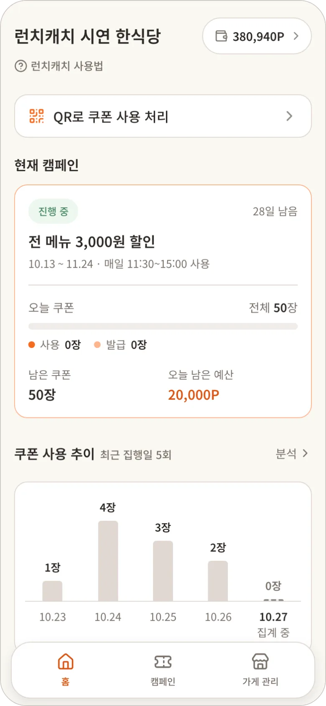
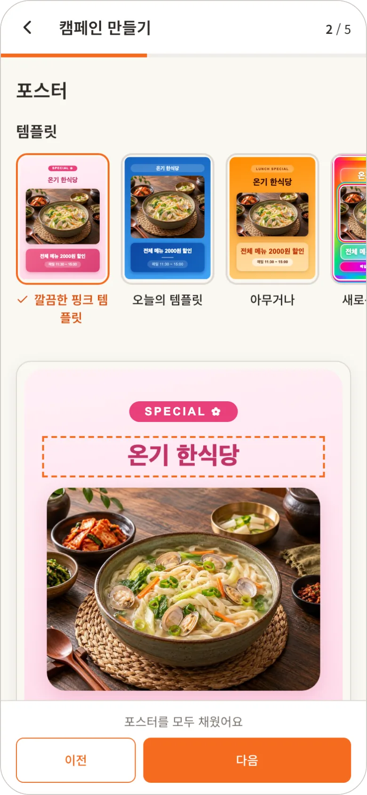
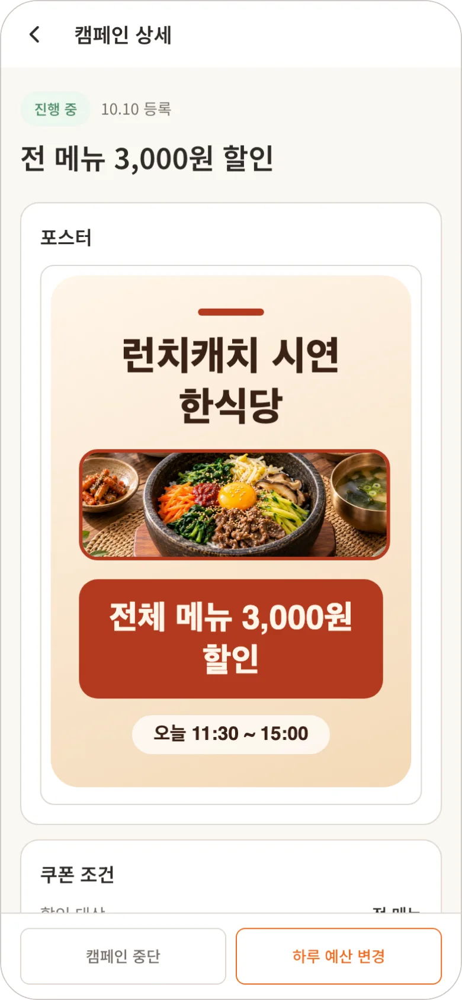
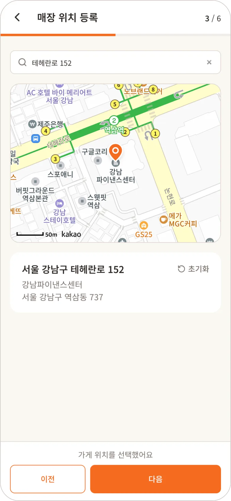
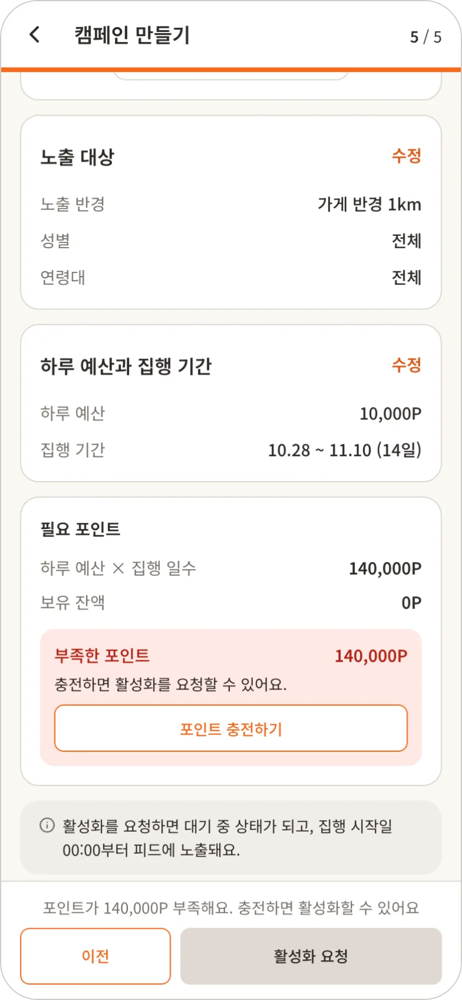
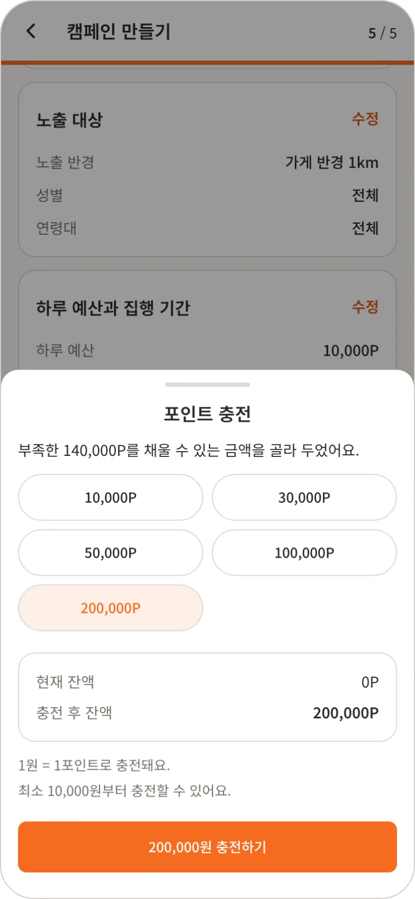

# 🍱 런치캐치 · 점주 앱

> 가게 사장님이 입점 등록을 하고, 템플릿으로 쿠폰 포스터를 만들어 점심 캠페인을 운영하는 모바일 웹
>
> **입점 신청 → 템플릿으로 포스터 제작 → 포인트 충전 후 캠페인 활성화 → 노출 · 발급 · 사용 성과 확인**

[← 프로젝트 README로 돌아가기](../../README.md)

| 홈 | 캠페인 생성 | 캠페인 상세 |
| :---: | :---: | :---: |
|  |  |  |

| 입점 신청 | 캠페인 확인 | 포인트 충전 |
| :---: | :---: | :---: |
|  |  |  |

<br>

## 목차

- [서비스 규칙](#서비스-규칙)
- [주요 화면](#주요-화면)
- [구현 고민](#구현-고민)
- [개선 과제](#개선-과제)
- [실행](#실행)
- [폴더 구조](#폴더-구조)

<br>

## 서비스 규칙

| 규칙 | 내용 |
| --- | --- |
| 입점 신청 | 약관 → 가게 정보 → 위치 → 영업시간 → 가게 이미지 → 대표 메뉴 6단계. 약관 4개는 모두 필수, 로고 필수, 매장 사진과 대표 메뉴(최대 3개)는 선택 |
| 입점 뒤 | 등록을 마치면 바로 영업 중(ACTIVE). 사진 · 메뉴는 보기만 하고, 영업시간은 바꿀 수 있음 |
| 캠페인 수 | 끝나지 않은 캠페인(작성 중 · 대기 · 진행 · 일시중지)은 한 번에 1개 |
| 활성화 | 포인트 잔액이 하루 예산 × 집행 일수 이상이어야 활성화 요청 가능 |
| 하루 예산 변경 | 진행 중인 캠페인만, 바꾼 값은 다음 날 00:00부터 적용 |
| 재개 | 점주가 직접 중단한 캠페인만 재개. 잔액 부족으로 멈춘 캠페인은 충전하면 다시 시작 |
| 포인트 | 토스페이먼츠로 충전, 1원 = 1포인트 |
| 쿠폰 사용 | 매장의 스캔 기기가 손님 QR을 읽어 사용 처리. 점주 앱의 QR 스캔은 시연용 임시 화면 |

<br>

## 주요 화면

| 화면 | 주소 | 설명 |
| --- | --- | --- |
| 로그인 · 입점 신청 | `/login`, `/signup/*` | 약관 동의, 가게 정보, 카카오맵 위치 검색, 영업시간, 가게 이미지, 대표 메뉴 |
| 홈 | `/home` | 진행 중인 캠페인과 최근 성과 |
| 캠페인 | `/campaigns`, `/campaigns/ended` | 현재 캠페인과 상태별 처리(이어서 작성, 중단, 재개, 하루 예산 변경), 지난 캠페인 목록 |
| 캠페인 등록 | `/campaigns/:id/edit/*` | 쿠폰 조건 → 포스터 → 노출 대상 → 하루 예산과 기간 → 확인 5단계, 단계마다 저장 |
| 캠페인 상세 | `/campaigns/:id` | 캠페인 상태와 포스터 확인 |
| 포인트 | `/points/*` | 충전, 포인트 변동 내역, 결제 내역, 환불 요청 |
| 가게 관리 | `/store`, `/store/*` | 가게 정보, 영업시간 수정, 사진 · 메뉴 보기, 쿠폰 사용 내역 |
| 리포트 | `/store/analytics` | 캠페인별 노출 · 발급 · 사용 현황 |
| QR 스캔 (시연용) | `/qr-scan` | 카메라로 손님의 쿠폰 QR을 읽어 사용 처리 |

<br>

## 구현 고민

### 나갔다 와도 이어지는 입점 신청

입점 신청은 6단계라 중간에 나갔다 다시 오는 경우가 많음. 단계마다 서버에 저장하고, 들어올 때 저장한 값과 진행 상태를 불러와 칸을 채운 뒤 이어갈 단계로 보냄. 불러오지 못한 채 진행하면 저장한 값을 빈 값으로 덮어쓸 수 있어, 그때는 다시 시도 화면을 보여줌. 저장이 서버의 진행 상태와 맞지 않아 거절되면 진행 상태를 다시 불러와 맞는 단계로 옮김. 약관은 한 번만 동의받는 API라 약관 단계로 돌아와 다시 "다음"을 누르면 거절되는데, 이미 동의한 상태면 오류 없이 넘어가게 함. 다른 창에서 입점 신청을 이미 마쳐 "입점 신청 중이 아님"으로 거절되면, 내 정보를 다시 받아 영업 중(ACTIVE) 상태로 바꾸고 홈으로 보냄.

### 결제창을 다녀와도 남는 작성 중인 캠페인

캠페인 확인 단계에서 잔액이 부족하면 바로 충전하러 감. 토스 결제창이 페이지를 옮겨 앱이 처음부터 다시 그려지므로, 아직 저장하지 않은 입력값(하루 예산 등)이 사라짐. 결제하러 가기 전 작성 중인 값을 `sessionStorage`에 두고, 돌아와 같은 캠페인을 열 때 한 번만 꺼내 씀. 30분이 지난 값은 버림. 결제 승인 확정은 응답이 "아직 확정 전"이거나 오지 않을 수 있어서, 승인 요청을 다시 보내지 않고 결제 상태 조회로 약 30초 동안 확인함.

### 고르면 바로 올라가는 사진

사진은 API 서버를 거치지 않고 S3에 바로 올리는 presigned URL 방식. 사진을 고르는 즉시 올리기 시작해 "다음"을 누를 때 기다리지 않게 하고, 진행률을 칸에 보여줌.

이 방식에서 신경 쓴 점은 **주소를 발급받는 순간 서버가 자리를 잡는다**는 것. 매장 사진은 확인하지 않은 업로드도 3장 중 한 자리를 차지해, 실패할 때마다 주소를 새로 받으면 화면의 사진이 3장보다 적어도 "3장 초과"로 거절됨. 자리는 발급한 순서대로 정해져 매장 사진은 한 장씩 차례로 올림. 로고는 발급하는 순간 기존 로고가 빠지고 가장 나중에 발급한 업로드만 확인해 줘, 다른 창에서 로고를 올렸으면 주소부터 새로 받음. 그래서 실패한 사진을 다시 시도할 때는 받은 주소를 되도록 다시 쓰고, 이미 끝낸 단계는 건너뜀.

| 단계 | 하는 일 | 다시 시도할 때 |
| --- | --- | --- |
| 1. 줄이기 | 긴 변이 1600px보다 크면 줄임. 발급 요청에 파일 크기를 보내야 해서 발급보다 먼저 함 | 주소를 다시 쓰면 처음에 줄인 파일을 그대로 씀. 다시 줄이면 크기가 달라져 서명과 맞지 않음 |
| 2. 업로드 주소 발급 | 파일 이름, 형식, 줄인 뒤의 크기를 보내면 10분 동안 쓸 수 있는 S3 주소를 줌. 서명에 형식과 크기가 들어가 발급 때 알린 파일만 올릴 수 있음 | 받은 지 9분이 안 됐으면 건너뜀 (올리는 도중 만료되지 않게 1분 여유). 9분이 지났거나 S3가 주소를 거절했으면(403) 새로 받음 |
| 3. S3에 올리기 | 받은 주소로 줄인 파일을 바로 올림. API 요청(10초)보다 오래 걸려 120초까지 기다림 | 다 올렸으면 건너뜀 |
| 4. 업로드 확인 | 서버가 S3에 올라간 파일을 확인해야 가게 · 메뉴에 사진이 붙음. 포스터 이미지는 이 단계 없이 받은 객체 키를 포스터 저장에 보냄 | 다시 부름 |

로컬에서는 S3 버킷의 CORS가 localhost를 막아 Vite 프록시(`/s3-upload`)를 거쳐 올림.

### 그 밖의 고민

| 주제 | 문제 | 선택 |
| --- | --- | --- |
| 활성화 전 잔액 확인 | 서버는 활성화할 때 잔액을 검사하지 않아, 잔액이 모자라도 요청이 통과됨 | 확인 단계에 들어올 때마다 잔액을 새로 불러와, 모르거나(불러오는 중 · 실패) 모자라면 버튼을 막고 부족한 포인트를 안내 |
| 캠페인 1개 제한 | 끝나지 않은 캠페인이 있으면 서버가 새 캠페인을 거절하고, 작성 중인 캠페인이 있으면 그 값을 덮어씀 | 새 캠페인을 시작할 때 목록을 먼저 확인해, 작성 중인 캠페인은 이어서 쓰고 진행 중인 캠페인이 있으면 미리 안내 |
| 포스터 미리보기 | 관리자가 LLM으로 만든 HTML이라 스크립트와 링크 이동이 가능하고, 내용을 바꿀 때마다 브라우저 방문 기록이 쌓여 뒤로 가기가 미리보기를 되돌림 | 비어 있는 `sandbox` iframe으로 그리고, 내용이 바뀌면 iframe을 새로 만듦. 작게 보여줄 때는 360px 기준으로 그린 뒤 줄임 |
| 로그인 유지 | 여러 요청이 동시에 401을 받으면 재발급이 겹침. 서버는 토큰을 바꾼 뒤 10초까지만 직전 Refresh Token을 받아 주고, 그 뒤에 오면 재사용으로 보고 로그인을 끊음 | 재발급은 진행 중인 요청 하나를 모두가 함께 기다리고, 끝나면 실패한 요청을 한 번 더 보냄. 재발급 전에 보낸 요청이 늦게 401을 받으면 재발급 없이 바뀐 쿠키로 다시 보내기만 함. 재발급이 503이거나 응답이 없으면 서버가 이미 토큰을 바꿨는지 알 수 없어, 같은 토큰으로 다시 보내지 않고 오류를 보여줌 |

<details>
<summary><b>더 보기</b></summary>

<br>

- **요청 시간 제한**: 서버가 연결만 받고 응답하지 않으면 앱 시작 시 내 정보 조회가 끝나지 않아 빈 화면이 계속됨. 모든 요청을 10초 뒤 끊음
- **요청 제한(429)**: 서버가 남은 시간을 초 단위로 내림해 주므로, 받은 시간보다 1초 더 기다린 뒤 다시 보냄
- **QR 사용 처리 문구**: 사장님이 계산대에서 손님에게 바로 말할 수 있는 문구로 실패 사유를 안내. 응답을 받지 못했으면 손님이 QR을 다시 띄우지 않아도 같은 QR로 다시 보냄

</details>

<br>

## 개선 과제

- **매장 스캔 기기 연동**: 지금 점주 앱의 QR 스캔은 시연용 임시 화면. 실제 사용 처리는 매장 스캔 기기에서 함
- **약관 · 플랫폼 설정값 연동**: 약관 본문과 최소 하루 예산은 받아 올 API가 없어 앱 안에 고정값(`api/mocks`)으로 둠
- **바꾼 하루 예산 표시**: 서버가 다음 날 적용될 하루 예산을 주지 않아 캠페인 상세에서 볼 수 없고, 바꾼 직후 안내만 보여줌
- **페이지 지연 로딩**: 모든 화면을 한 번에 불러오고 있어 경로별로 나눠 받는 작업이 필요

<br>

## 실행

- 루트 폴더에서 실행
- 설치와 공통 환경 변수: [포팅 매뉴얼](../../README.md#포팅-매뉴얼)
- 기술 스택: React 19, TypeScript, Vite, React Router, Tailwind CSS v4, 카카오 지도, 토스페이먼츠 결제위젯

```bash
pnpm dev:owner   # http://localhost:5174
```

`apps/owner/.env.local`에 넣는 값 (설명은 [.env.example](.env.example))

| 변수 | 내용 |
| --- | --- |
| `API_PROXY_TARGET` | 로컬 Vite 프록시가 요청을 넘길 API 서버. 비우면 `http://localhost:8080` |
| `S3_UPLOAD_PROXY_TARGET` | 로컬 Vite 프록시가 사진 업로드를 넘길 S3 버킷. 비우면 개발 서버 버킷. `API_PROXY_TARGET`을 다른 서버로 바꾸면 그 서버가 쓰는 버킷으로 함께 바꿔야 업로드가 됨 |
| `VITE_KAKAO_JS_KEY` | 입점 신청 위치 검색용 카카오 지도 키. 카카오에 등록한 도메인(`localhost:5174` 등)에서만 동작 |
| `VITE_TOSS_CLIENT_KEY` | 포인트 충전 결제위젯 클라이언트 키. 시크릿 키는 백엔드에만 둠 |
| `VITE_MOCK_OWNER_STATUS` | `ACTIVE` 또는 `ONBOARDING`을 넣으면 서버에 묻지 않고 그 상태로 로그인한 것으로 봄. 로컬 개발에서만 읽음 |

<br>

## 폴더 구조

```
src/
├── app/            # 라우터
├── pages/          # 주소 하나에 대응하는 화면
├── features/
│   ├── login/          # 점주 로그인
│   ├── signup/         # 입점 신청 6단계
│   ├── home/           # 홈 대시보드, 첫 방문 안내
│   ├── campaign/       # 캠페인 목록, 등록 단계, 상세, 상태별 처리, 포스터 미리보기
│   ├── points/         # 포인트 충전(토스), 변동 · 결제 내역, 환불
│   ├── store/          # 가게 관리
│   ├── couponUsage/    # 쿠폰 사용 내역
│   ├── analytics/      # 리포트
│   ├── qrScan/         # QR 스캔 (시연용)
│   └── routeNotice/    # 없는 주소 · 오류 화면
├── ui/             # 여러 기능이 함께 쓰는 컴포넌트
├── hooks/          # 여러 기능이 함께 쓰는 훅
├── layout/         # 화면 틀
├── api/            # 서버 요청 함수와 고정값(mocks)
└── auth/           # 로그인 상태와 접근 제어
```
