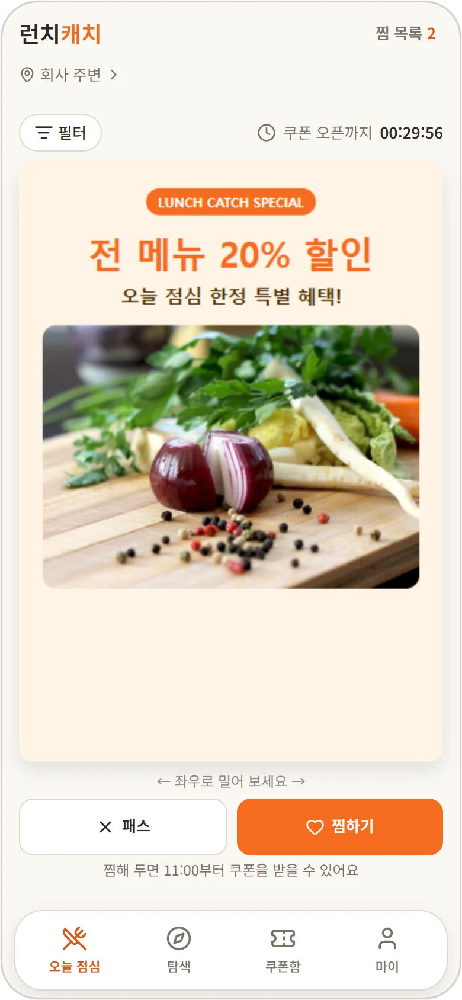
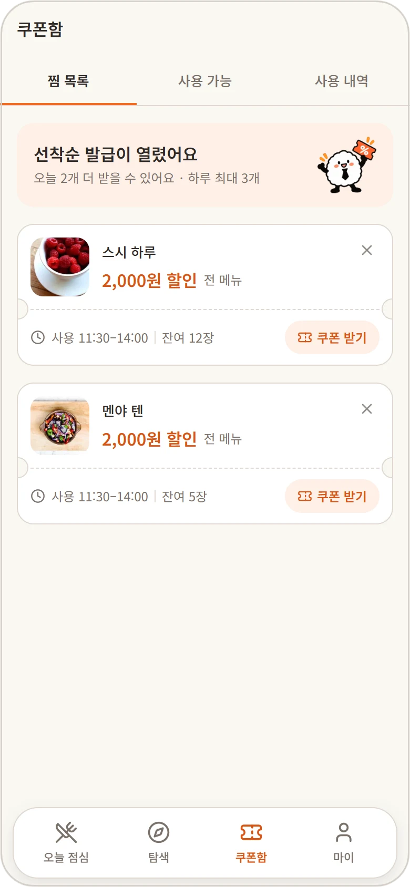
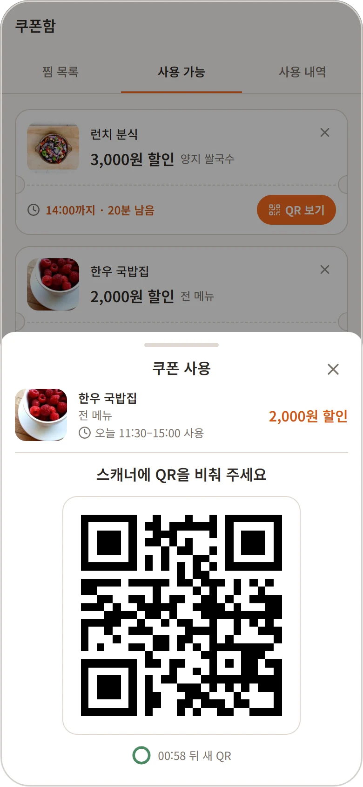
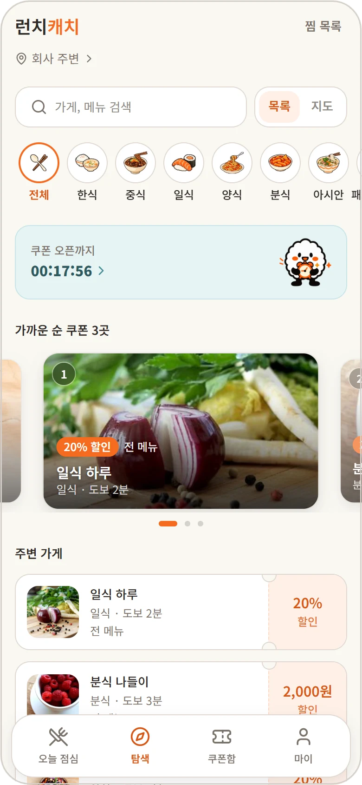
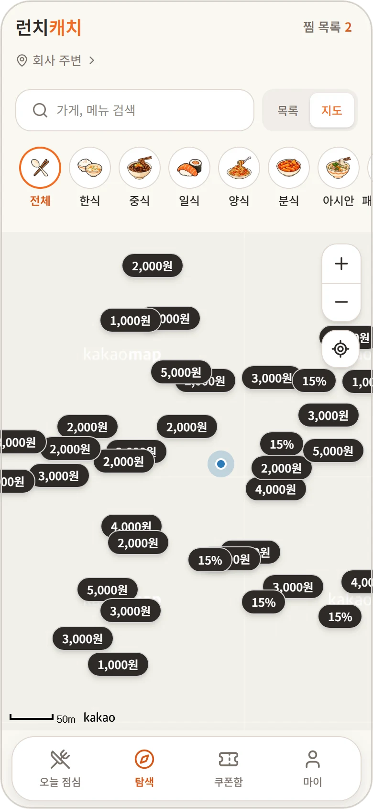
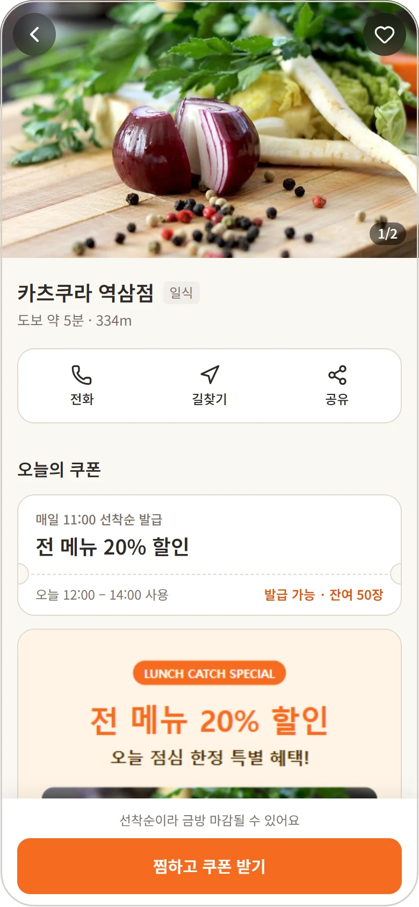

# 🍱 런치캐치 · 사용자 앱

> 회사 근처 가게의 점심 쿠폰을 직장인에게 이어주는 위치 기반 모바일 웹
>
> **오늘 점심을 넘겨 보며 찜 → 11:00 선착순 발급 → 매장에서 QR로 사용**

[← 프로젝트 README로 돌아가기](../../README.md)

| ① 오늘 점심 | ② 찜 목록 | ③ 쿠폰 QR |
| :---: | :---: | :---: |
|  |  |  |

| 탐색 | 지도 보기 | 가게 상세 |
| :---: | :---: | :---: |
|  |  |  |

<br>

## 목차

- [서비스 규칙](#서비스-규칙)
- [주요 화면](#주요-화면)
- [구현 고민](#구현-고민)
- [개선 과제](#개선-과제)
- [실행](#실행)
- [폴더 구조](#폴더-구조)

<br>

## 서비스 규칙

| 규칙 | 내용 |
| --- | --- |
| 발급 시간 | 매일 11:00 선착순 오픈, 14:00 마감 |
| 발급 대상 | 찜한 쿠폰만 가능. 오늘 점심 카드에는 발급 버튼이 없음 |
| 한도 | 하루 최대 3개, 같은 쿠폰은 한 번만 |
| 수량 | 가게마다 정해진 수량만큼만 발급, 소진되면 마감 |
| 사용 | 매장에서 QR을 보여주면 점주가 스캔. QR은 60초마다 새로 만들어지는 1회용 |

<br>

## 주요 화면

| 화면 | 주소 | 설명 |
| --- | --- | --- |
| 로그인 · 온보딩 | `/login`, `/onboarding` | 카카오 로그인, 약관 동의, 관심 업종과 내 위치 설정, 서비스 안내 |
| 오늘 점심 | `/swipe` | 쿠폰 포스터 카드를 넘기며 찜 또는 패스. 업종 · 정렬 필터 |
| 찜 목록 | `/coupons/wishlist` | 11:00 카운트다운, 오픈 뒤 쿠폰 발급, 오늘 끝난 찜은 접어서 정리 |
| 쿠폰함 | `/coupons`, `/coupons/history` | 받은 쿠폰의 QR, 사용 · 만료 내역 |
| 탐색 | `/explore` | 오픈 안내 배너, 가까운 쿠폰 슬라이드, 가게 목록 · 지도, 업종 필터, 검색 |
| 가게 상세 | `/stores/:storeId` | 메뉴, 영업 정보, 위치, 오늘의 쿠폰과 포스터, 바로 찜 · 발급 |
| 마이페이지 | `/my` 아래 | 프로필, 내 위치, 동의 항목, 화면 테마, 회원 탈퇴 |

<br>

## 구현 고민

### 11:00 오픈 시각 맞추기

11:00이 되면 새로고침 없이 받기 버튼이 나와야 하고, 화면을 켜 둔 채 날이 바뀌어도 안내가 맞아야 함. 하루 종일 1초마다 시계를 돌리면 화면이 계속 다시 그려져서 단계별로 나눔. 오픈 전에는 1초마다, 발급 중에는 14:00에 한 번, 마감 뒤에는 다음 날 00:00에 한 번만 깨움. 한 번만 알면 되는 곳(찜한 직후의 토스트)은 시계 없이 그 순간의 단계만 계산함.

### 화면 번쩍임 줄이기

응답이 빠르면 회색 로딩 틀이 잠깐 나왔다 사라져 오히려 화면이 깜빡임. 로딩이 300ms를 넘을 때만 틀을 보여주고, 한 번 보여준 틀은 400ms 동안 유지함. 목록을 다시 받을 때는 비우지 않고 이전 목록을 남기며, 틀의 높이를 실제 화면과 맞춰 내용이 밀리지 않게 함. 화면마다 프레임 단위로 위치와 표시 여부를 측정해 확인함.

### 섞여 오는 가게 목록 구성

서버가 쿠폰 가게와 일반 가게를 거리순으로 섞어 내려줌. "쿠폰 가게 / 다른 가게"로 나누면 더 불러올 때마다 쿠폰 가게가 위로 끼어들어 개수가 바뀌고 보던 자리가 흐트러짐. 서버 정렬 변경은 어려워 프론트에서 구조를 바꿈. 쿠폰 가게는 위의 가까운 순 슬라이드가 맡고, 아래는 하나의 목록에 "가게 더 보기"로 10곳씩 맨 아래에만 붙임. 새 가게가 항상 맨 아래에 붙어 보던 내용이 움직이지 않음. 가게 상세를 보고 돌아오면 받아 둔 목록, 펼친 개수, 스크롤 위치를 5분 동안 메모리에 두었다가 복원함.

### 그 밖의 고민

| 주제 | 문제 | 선택 |
| --- | --- | --- |
| 스와이프 이어 붙이기 | 마지막 카드 뒤에 로딩 화면이 뜨고, 피드 API 요청 제한 때문에 탭을 오갈 때마다 다시 받을 수 없음 | 남은 카드가 2장 이하면 다음 피드와 포스터 이미지를 미리 받아 이어 붙임. 요청할 수 있는 시각에만 받고 앱이 뒤로 가 있으면 받지 않음. 보던 카드는 탭을 닫기 전까지 저장하되, 30분이 지났거나 날짜가 바뀌면 버림 |
| 점주 포스터 표시 | 점주가 만든 HTML이라 그대로 그리면 스크립트와 외부 이동이 가능하고, 이미지가 늦게 뜨면 카드가 번쩍임 | `sandbox` iframe 안에서만 그리고, 포스터 속 이미지까지 받은 뒤 서서히 보여줌. A4 비율에 맞춰 화면 높이로 폭을 계산 |
| 선착순 발급 | 11:00 직후 연타, 수량 소진, 한도 초과, 요청 폭주가 한꺼번에 생김 | 발급은 한 번에 하나만 진행하고 실패 사유마다 다른 안내를 보여줌. 성공이든 실패든 잔여 수량과 쿠폰 목록을 다시 받고, 다시 받지 못하면 받은 카드만 직접 "받음"으로 바꿈 |
| 로그인 유지 | 여러 요청이 동시에 401을 받아 재발급이 겹치면, 서버가 같은 Refresh Token의 재사용으로 보고 모든 로그인을 끊음 | 재발급은 진행 중인 요청 하나를 모두가 함께 기다림. 서버 일시 오류(503)나 네트워크 오류는 로그인을 끊지 않고 오류만 올림 |

<details>
<summary><b>더 보기</b></summary>

<br>

- **QR은 60초마다 새로**: 쿠폰 QR은 60초짜리를 받아 만료되면 새로 받음. 연결이 끊기면 새로 받지 않고 마지막 QR을 그대로 두며, 이미 사용했거나 사용 시간이 아니면 쿠폰 상태 확인이 화면을 바꿈
- **움직임 줄이기 존중**: 로그인 첫 등장 효과, 카운트다운 숫자 롤링, 슬라이드 자동 넘김을 `prefers-reduced-motion`에서는 모두 끔
- **터치 기기의 hover**: 모바일에서 탭한 뒤 마우스가 올라간 것으로 남아 자동 넘김이 멈추는 문제를, 마우스 포인터일 때만 hover로 보게 해 해결

</details>

<br>

## 개선 과제

- **서버 시각 기준 카운트다운**: 지금은 휴대폰 시계를 기준으로 하고 있어 시계가 틀리면 오픈 시각이 어긋남. 서버 시각과의 차이로 보정하는 작업이 필요
- **미리 받은 피드 묶음 보존**: 화면을 떠났다 돌아오면 미리 받아 둔 묶음은 사라지고 평소 경로로 다시 받음. 묶음 자체를 세션에 저장하는 방식으로 개선 가능
- **쿠폰 가게 우선 정렬**: 서버가 쿠폰 가게를 먼저 정렬해 주면 프론트의 슬라이드와 목록 분리 없이도 같은 경험을 만들 수 있음

<br>

## 실행

- 루트 폴더에서 실행
- 설치와 환경 변수: [포팅 매뉴얼](../../README.md#포팅-매뉴얼)
- 가게, 쿠폰, 피드는 모두 백엔드 API를 호출하므로 서버가 있어야 화면이 채워짐
- 기술 스택: React 19, TypeScript, Vite, React Router, Tailwind CSS v4, 카카오 로그인 · 지도

```bash
pnpm dev:user   # http://localhost:5173
```

<details>
<summary><b>시각 바꿔 확인하기 (개발 모드)</b></summary>

<br>

- 주소 뒤에 `?mockTime=` 옵션을 붙이면 그 시각부터 시계가 흐르고, 앱 안에서 화면을 옮겨도 유지
- 서버 응답은 실제 서버 시각 기준이라 화면의 시각만 바뀜. 오픈 전후 화면과 카운트다운 확인용

| 옵션 | 확인할 수 있는 상태 |
| --- | --- |
| `?mockTime=10:30` | 11:00 오픈 전 (카운트다운, 오픈 전 배너) |
| `?mockTime=10:59:50` | 11:00 오픈 직전부터 오픈 순간까지 |
| `?mockTime=11:30` | 선착순 발급 중 |
| `?mockTime=15:00` | 오늘 발급 마감 뒤 |

</details>

<br>

## 폴더 구조

```
src/
├── app/            # 라우터
├── pages/          # 주소 하나에 대응하는 화면
├── features/
│   ├── login/          # 카카오 로그인, 스플래시
│   ├── onboarding/     # 약관 동의, 관심 업종 설정
│   ├── location/       # 내 위치 설정, 주소 검색
│   ├── tutorial/       # 서비스 안내
│   ├── swipe/          # 오늘 점심 스와이프 피드
│   ├── wishlist/       # 찜 목록, 11:00 오픈 카운트다운
│   ├── coupon/         # 쿠폰함, QR, 사용 내역
│   ├── explore/        # 탐색 배너, 슬라이드, 목록, 지도
│   ├── store-detail/   # 가게 상세
│   └── mypage/         # 프로필, 설정, 회원 탈퇴
├── ui/             # 여러 기능이 함께 쓰는 컴포넌트
├── hooks/          # 여러 기능이 함께 쓰는 훅 (오픈 카운트다운, 포스터 미리 받기 등)
├── layout/         # 하단 탭바, 상단 바 틀
├── api/            # 서버 요청 함수와 mock 데이터
└── auth/           # 로그인 상태와 접근 제어
```
